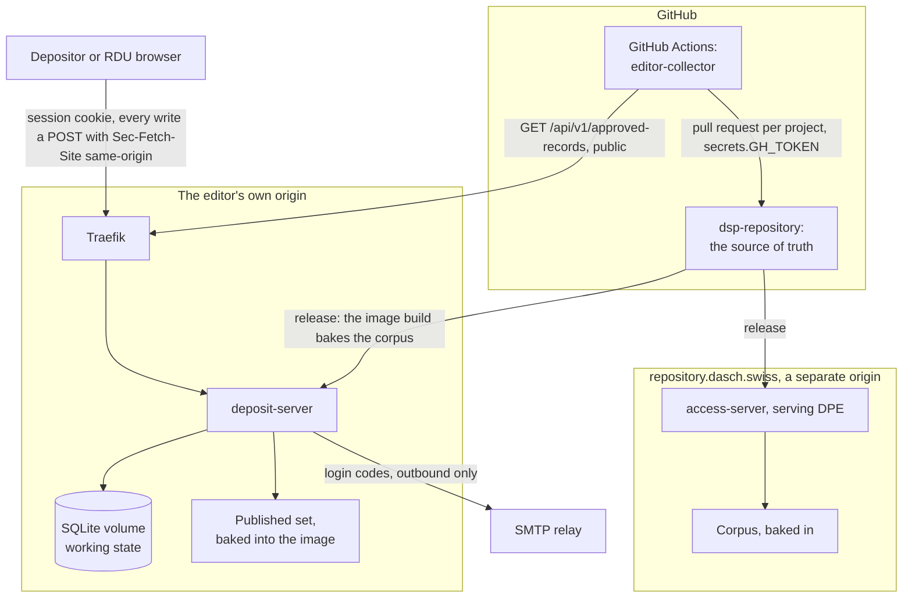

# Editor Architecture

The metadata editor is the Deposit Area's first capability (ADR-0002, ADR-0003): the surface where a depositing project team edits its project metadata, RDU reviews it field by field, and an approved record is carried back into this repository as a pull request. Git stays the source of truth and the editor's database is working state (`areas/deposit/ADR-0001`).

This page describes the architecture **as implemented**. The Deposit Area's target lives only in its decision records, `areas/deposit/docs/adr/`, and the code matches them today; a gap that opens gets a "Divergence from the target architecture" section at the end of this page again (`areas/deposit/editor/CLAUDE.md`). Subsystem detail is on the topic pages each section links to.

## The flow, end to end

```mermaid
flowchart LR
  D[Depositor] -->|edits, section by section| Draft
  Draft -->|submit| Sub[Submission]
  Sub -->|RDU decides each changed field| Round[Review round]
  Round -->|approve, one transaction| AR[Approved record]
  AR -->|GET /api/v1/approved-records| C[editor-collector<br/>in GitHub Actions]
  C -->|one pull request per project| PR[Pull request on<br/>this repository]
  PR -->|CI checks, human merge, release| Corpus[Published project files]
  Corpus -->|baked into the image| DPE
  Corpus -->|baked into the image| E[editor, next deployment]
  E -->|reconcile at startup| Online
```

- A **Draft** is the depositor's working copy: the project's JSON members verbatim, one per project, last write wins ([The Project Representation](./project-representation.md), `areas/deposit/ADR-0002`).
- A **Submission** is the draft as submitted, at most one per project. RDU claims it, decides each changed field, substitutes values beside the payload rather than over it, and ends the round with approve, request changes or reject; the depositor can withdraw ([The Review Surface](./review.md)).
- Approve writes the **Approved record**, the submitted draft with every decision applied, deletes the submission and appends the **Review round**, all in one transaction. The record waits to be collected.
- The **collector** runs in GitHub Actions, never in the service. It reads every approved record over the editor's API, writes each project's onto an `editor-collect/<shortcode>` branch, and opens or updates one pull request per project ([Collection](./collection.md)). Nothing is reported back. The pull request, its CI checks and a human merge are the gate between the editor and anything served.
- **Online** is never stored. The merged file is baked into the next editor image, and the editor compares its records with that published set once at startup: a record whose data is published is discarded, and the project reads Online ([Project State and Online Detection](./status.md), `areas/deposit/ADR-0003`).

## Components and crates

| Crate | Folder | Role |
|-------|--------|------|
| `editor-core` | `areas/deposit/editor/core` | The domain: the draft, the review diff, project state, the canonical project and entity writers, the published set, and one repository port per aggregate (no Axum, Maud or database dependency) |
| `deposit-shell` | `areas/deposit/shell` | The area's document shell: `page`, the header and footer, the 403, 404 and problem pages, the sign-in link (`safe_next`, `login_url`) and the RDU-only text; depends on `maud` and `mosaic-tiles` only |
| `identity-core` | `areas/deposit/identity/core` | Identity's domain: `User`, `Role`, `Session`, `LoginCode`, the login and session rules, code and token generation, the cookie names, the `Mailer` trait, and one repository port per aggregate with their `IdentityRepositories` bundle (no Axum, Maud or database dependency, and no `editor-*` dependency) |
| `identity-ports` | `areas/deposit/identity/ports` | What identity asks of the editor: `AuthoredWork` (an account's open drafts and submissions) and its fake; `std` only |
| `identity-store` | `areas/deposit/identity/store` | Identity's SQLite store, the file `identity.sqlite`: the tables behind identity's four repository ports, its migration and pool, the mail transports (`SmtpMailer`, `ConsoleMailer`) behind `identity-core`'s `Mailer`, and the adapters `LiveAuthenticator` and `LiveUserDirectory` behind `editor-ports` |
| `identity-web` | `areas/deposit/identity/web` | Identity's HTTP surface: the login and depositor pages, their handlers and route table, identity's own `Authenticated`/`Rdu` extractors and the `Set-Cookie` glue, and the `Identity` facade (`start`: the RDU accounts, the mailer and the hourly sweep; `router`) |
| `editor-ports` | `areas/deposit/editor/ports` | What the editor asks of identity: `Actor`, `Authenticator`, `UserDirectory` and their fakes; `std` only |
| `editor-store` | `areas/deposit/editor/store` | The editor's SQLite store, the file `editor.sqlite`: the tables behind `editor-core`'s five repository ports, its migration and pool, and the adapter `LiveAuthoredWork` behind `identity-ports`; no foreign keys |
| `editor-web` | `areas/deposit/editor/web` | The editor's HTTP surface: the Maud views (pages, the form's field registry and widgets), the handlers and route table, the editor's `Authenticated`/`Rdu` extractors over `Authenticator`, the startup reconcile, and the `Editor` facade (`start`: the published set, the temporal tables, the agents and the reconcile; `router`) |
| `deposit-server` | `areas/deposit/server` | The binary and composition root: configuration, observability, the CSRF and OTel layers, the untraced routes, the page-URL normalizer built from both web crates' route paths, and the fallback 404; opens the two stores, starts identity and then the editor, and merges their routers |
| `editor-collector` | `areas/deposit/editor/collector` | The CI binary that turns approved records into pull requests ([Collection](./collection.md)) |

Dependency direction is `server → web → core`. `deposit-server` depends on the two web crates (`identity-web` and `editor-web`, which it mounts through the `Identity` and `Editor` facades), the two store crates, the two ports crates and `deposit-shell`, and on no `core` crate, dev-dependencies included (`.github/scripts/check-composition-root-deps.sh`). `identity-web` depends on identity's own crates, `deposit-shell`, `mosaic-tiles` and `shared-*`; `deposit-shell` depends on no capability crate; `identity-core` depends on no editor crate; the two ports crates depend on `std` alone; the two store crates each depend on their own core crate and on the other capability's ports crate, the one it answers; `editor-collector` sits outside that chain, depending on `editor-core` and `shared-metadata` alone and running as a batch job rather than serving a request. `editor-web` depends on `editor-core` for the project representation it renders and the repository ports it reads through, on `editor-ports`, `deposit-shell`, `mosaic-tiles` and `shared-*`, and on no identity crate. `.github/scripts/check-capability-deps.sh` (`just check`) holds the edges between capabilities, from a capability or the shell to anything outside its area, and from a ports crate to anything but `shared-*`, and it keeps third-party crates out of the ports crates, web frameworks, Maud and database crates out of the core crates, and web frameworks out of the shell; inside a capability it allows any workspace edge, and the root's edges are `check-composition-root-deps.sh`'s. Component CSS is collected from the Tailwind entry's `@source` globs rather than from the crate graph, so it ships independently of that dependency ([Rendering](./rendering.md)).

Unlike DPE, the **HTML document shell is the area's, not a capability's**: `deposit-shell` (`areas/deposit/shell`) holds the document, header and footer, the 403, 404 and problem pages, the sign-in link with the area's one open-redirect check (`safe_next`), and the RDU-only text, so identity's pages and the editor's share one copy without either depending on the other. It depends on no capability crate and has no Axum: `editor-web`'s and `identity-web`'s `shell.rs` each turn its markup into responses, and `deposit-server`'s renders the fallback 404. The routes it links (`/`, `/projects`, `/login`, `/logout`) are string literals.

Inside `deposit-server`, `serve.rs` opens both stores, starts identity through `identity_web::Identity::start` and then the editor through `editor_web::Editor::start`, handing the editor `identity-store`'s `LiveAuthenticator` and `LiveUserDirectory`; `router.rs` merges the two routers and owns the layer order ([Routing](./routing.md)). Inside `editor-web`, the handlers are one module per surface under `handlers/` (`sections`, `review`, `entities`, `projects`, `collection`), and only they use Axum; `EditorState` holds `editor: Arc<dyn EditorRepositories>`, the editor store's implementation of `editor-core`'s five repository ports ([Persistence](./persistence.md)), and the two ports it asks identity through: the handlers authenticate through `Authenticator` (`handlers/auth.rs`) and read names through `UserDirectory`. `reconcile` runs the startup comparison inside `Editor::start`. Identity's state, inside `identity-web`, holds `Arc<dyn IdentityRepositories>` (`identity-core`'s four ports), the mailer, and `AuthoredWork`, through which the depositor-removal confirmation reads open work.

Outside the area the editor depends on `shared-metadata` (the research-metadata contract), `shared-telemetry` (the browser beacon) and `mosaic-tiles`, and on nothing else in the workspace. It never depends on a `dpe-*` crate: DPE's corpus is consumed as data, an image-baked snapshot handed over as `EDITOR_DATA_DIR`, never as code (ADR-0002).

## Deployment topology and trust boundaries

Five boundaries, and what holds each:

- **Browser to editor.** A session comes from a one-time login code sent by mail; there are no passwords. Every state-changing route is `POST` and passes the `Sec-Fetch-Site: same-origin` check, applied as the outermost layer so no route escapes it. Access is two extractors, `Authenticated` and `Rdu`, not a middleware: a handler that names neither is public in its signature ([Authentication](./authentication.md), [Routing](./routing.md)).
- **Editor to DPE.** Separate deployables on separate origins; see [Relationship to DPE](#relationship-to-dpe).
- **CI to editor.** The collector only reads the editor: `GET /api/v1/approved-records` is public and rate-limited, and nothing is written back. The editor holds no credential at all and makes no outbound GitHub call ([Collection](./collection.md)).
- **Editor to repository.** Only through the pull request the collector opens. The collector writes a disposable checkout on its own `editor-collect/<shortcode>` branch, never in place, and refuses to force-push over a tip it did not write. The pull request is opened with `secrets.GH_TOKEN` so the repository's checks run on it.
- **Editor to the relay.** Outbound only, and no address ever reaches a log ([Authentication](./authentication.md#mail)).

### Relationship to DPE

The editor is a **separate service** from DPE, not a section of it. They share `shared-telemetry` for the browser-beacon contract, `shared-metadata` for the research-metadata contract and `mosaic-tiles` for components — but not a process, an image, or an origin.

The separation is deliberate:

- DPE is public, unauthenticated and read-only. The editor is authenticated and writes state. A host-level compromise of one should not hand over the other's session cookies.
- The editor's CSRF defence requires `Sec-Fetch-Site: same-origin` on every state-changing request. On a shared origin, a request originating from DPE *is* same-origin — so any XSS in DPE, which has a far larger unauthenticated attack surface, could drive authenticated editor mutations. A `Path` on a cookie is not a security boundary and does not close this.

ADR-0002 records the same choice at the platform level: one modulith per area, never one binary for the whole platform.

## Persistence, in one paragraph

Two SQLite databases on a volume, `identity.sqlite` and `editor.sqlite`, `rusqlite` bundled into the static binary. `identity-core` and `editor-core` own the records and one repository trait per aggregate; `identity-store` implements identity's four and `editor-store` the editor's five, so handlers depend on the ports and not on the driver. The editor's account columns are plain text, not foreign keys, because they point into the other database. Each store has its own pool and migration. A writer pool of exactly one connection and a reader pool of several make the single-writer rule structural, per database: readers are `query_only`, and the only write path opens `BEGIN IMMEDIATE`. Every multi-table transition is one repository method in one transaction. Nothing in either database is irreplaceable ([Persistence](./persistence.md), [Operations](./operations.md#backups)).

## Rendering and requests, in one paragraph

Server-rendered HTML with Maud, served by Axum, Datastar for enhancement on top of forms that work without it (ADR-0004). Paths are root-mounted on the editor's own hostname. Every write shares its URL with the `GET` that renders its form and answers two ways, a redirect on the plain path and the changed region as `text/html` on the enhanced one. Two layers wrap the app, CSRF outermost and OTel inside it, and `/healthz` and the telemetry beacon are declared after the OTel layers on purpose, so they stay untraced ([Routing](./routing.md), [Rendering](./rendering.md), [Observability](./observability.md)).

## Decisions

- Platform: the areas and the origin split (ADR-0002), one modulith per area with capabilities behind consumer-defined ports (ADR-0003, amended 2026-09-25 for authentication ports, the area shell and the crate-graph gate, and 2026-10-13 for what a composition root depends on), hypermedia surfaces (ADR-0004), where decision records live (ADR-0006).
- The editor's own: git as the source of truth (`areas/deposit/ADR-0001`), the draft as the project's JSON members (`areas/deposit/ADR-0002`), Online derived at startup (`areas/deposit/ADR-0003`), and the target shape of the area (`areas/deposit/ADR-0004`, amended 2026-10-13 for `identity-ports`, the session deadline in `Actor`, the web facades and the shell's sign-in link).
